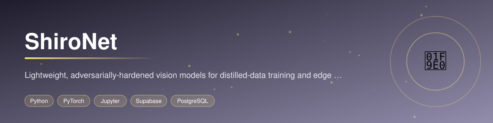
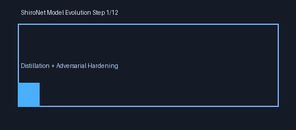
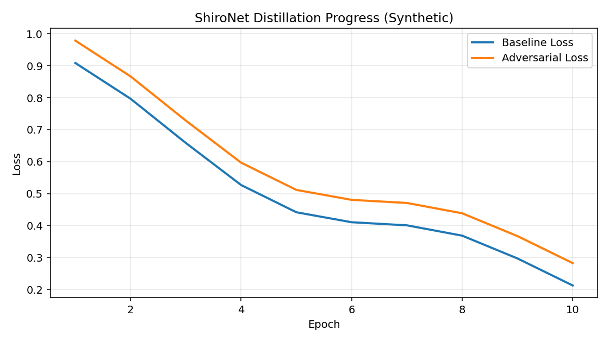
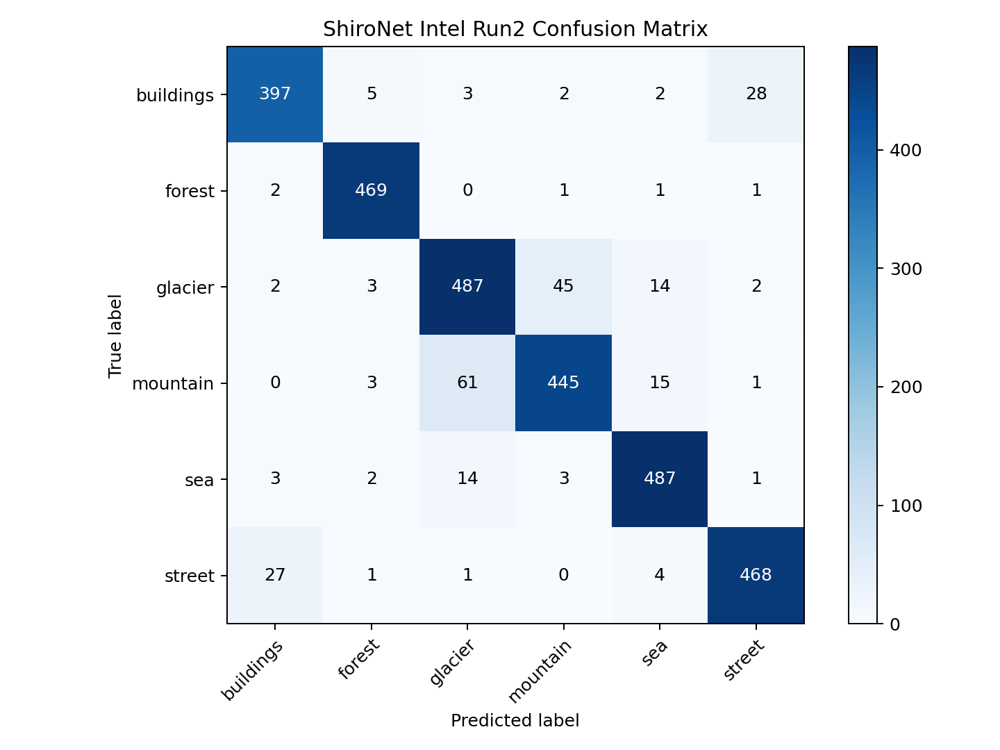
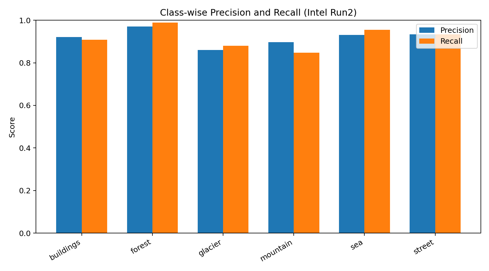
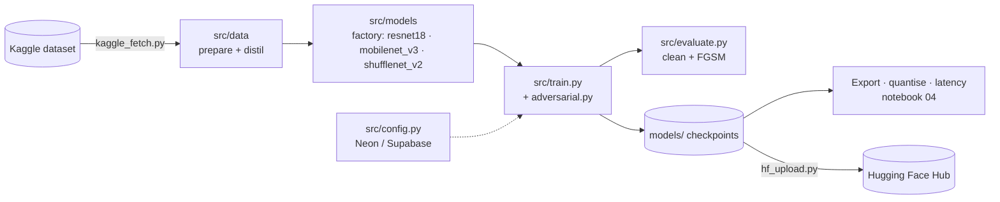

<div align="center">



# 🧠 ShiroNet

### Lightweight, adversarially-hardened vision models for distilled-data training and edge inference

    

[](LICENSE)    

[](https://codespaces.new/shiroonigami23-ui/shironet?quickstart=1) [](https://github.com/shiroonigami23-ui/shironet/archive/refs/heads/main.zip)

[**Overview**](#-overview) · [**Features**](#-features) · [**Architecture**](#-architecture) · [**Getting Started**](#-getting-started) · [**Roadmap**](#-roadmap)

</div>

---

## 📸 Preview

<p align="center">
  
  
  
  
</p>

## 📖 Overview

**ShiroNet** is a practical vision framework for training under tight compute budgets and deploying to the edge. It combines
three ideas — **dataset distillation**, **adversarial hardening** and **edge-friendly backbones** — into one reproducible
pipeline that runs on a free Kaggle T4 GPU and publishes checkpoints to Hugging Face.

On the Intel Image Classification (scenes) benchmark, using the same split and backbone as the baseline pipeline:

| Metric | Baseline | ShiroNet | Δ |
|---|---|---|---|
| Clean test accuracy | 82.13 % | **85.07 %** | **+2.93 pts** |
| FGSM accuracy (ε = 0.01) | 26.93 % | **73.03 %** | **+46.10 pts** |

*These are apples-to-apples results against our own baseline on Intel Scenes — not ImageNet-1k leaderboard numbers.*

### ✨ Highlights

- **+46 points** of FGSM robustness with **+3 points** of clean accuracy over the baseline
- **Three edge backbones** — ResNet-18, MobileNet-V3-Small, ShuffleNet-V2 ×0.5
- **Export / quantisation / latency** benchmarking notebook for deployment decisions
- **Kaggle → Hugging Face** workflow scripts for data fetch and checkpoint upload

## 🧩 Features

| Feature | What it does |
|---|---|
| **Data pipeline** | `src/data/` — dataset preparation, processing and distillation logs |
| **Model factory** | `src/models/factory.py` + `backbone.py` — swap backbones by name |
| **Adversarial training** | `src/training/adversarial.py` — FGSM-style hardening hooks and schedules |
| **Config layer** | `src/config.py` — env-driven settings incl. Neon Postgres / Supabase integration |
| **Evaluation** | `src/evaluate.py` — accuracy, confusion matrix, precision-recall, robustness |
| **Kaggle tooling** | `scripts/kaggle_fetch.py`, GPU training & benchmark kernels in `kaggle/` |
| **HF publishing** | `scripts/hf_upload.py` pushes checkpoints to a Hugging Face repo |
| **Notebook track** | Five notebooks: baseline → distillation → edge training → export/quantisation → results |

## 🛠 Tech Stack

| Layer | Technology |
|---|---|
| Training | Python 3.11, PyTorch (TensorRT for inference) |
| Backbones | ResNet-18, MobileNet-V3-Small, ShuffleNet-V2 ×0.5 |
| Data & infra | Kaggle T4 GPUs, Hugging Face Hub |
| Backend integrations | Neon serverless Postgres, Supabase |
| Tooling | pytest, Jupyter, MyTorch bridge |

## 🏗 Architecture

Data → model factory → adversarial trainer → evaluation/export, with Kaggle and Hugging Face at the edges.



➡️ Full design notes, data flow and design decisions: **[docs/ARCHITECTURE.md](docs/ARCHITECTURE.md)**

## 📁 Project Structure

```text
shironet/
├── src/
│   ├── data/        # prepare_dataset.py, processing.py
│   ├── models/      # backbone.py, factory.py
│   ├── training/    # adversarial.py
│   ├── config.py · train.py · evaluate.py · __main__.py
├── notebooks/       # 01 baseline → 05 Kaggle T4 results
├── kaggle/          # GPU training & benchmark kernels
├── scripts/         # kaggle_fetch.py, hf_upload.py
├── docs/            # architecture, protocols, benchmark & optimisation reports
├── tests/           # pytest config tests
└── data/ · models/
```

## 🚀 Getting Started

### Prerequisites

- Python 3.11+
- Optional: Kaggle API token (`~/.kaggle/kaggle.json`) and a Hugging Face token

### 1. Get the code

Pick whichever method suits you:

| Method | Command |
|---|---|
| **HTTPS** | `git clone https://github.com/shiroonigami23-ui/shironet.git` |
| **SSH** | `git clone git@github.com:shiroonigami23-ui/shironet.git` |
| **GitHub CLI** | `gh repo clone shiroonigami23-ui/shironet` |
| **ZIP** | [Download](https://github.com/shiroonigami23-ui/shironet/archive/refs/heads/main.zip) and extract |
| **Codespaces** | [Open in browser](https://codespaces.new/shiroonigami23-ui/shironet?quickstart=1) — zero local setup, dev container preconfigured |

> 🔑 **Using SSH for the first time?** Generate a key with `ssh-keygen -t ed25519 -C "you@example.com"`, add the `.pub` contents at **GitHub → Settings → SSH and GPG keys**, then test with `ssh -T git@github.com`.

### 2. Install & set up

```bash
cd shironet
python -m venv .venv && source .venv/bin/activate   # Windows: .venv\Scripts\activate
pip install --upgrade pip
pip install -r requirements.txt
cp .env.example .env                                 # fill in DB / HF settings if needed
```

### 3. Run

```bash
python -m src                                         # default pipeline
python scripts/kaggle_fetch.py --dataset puneet6060/intel-image-classification --out data/raw
python scripts/hf_upload.py --repo-name shironet-edge --local-dir models/intel_run \
       --path-in-repo checkpoints/intel-run --private
pytest                                                # tests
```

## 🎮 Usage

**Notebook workflow**

| # | Notebook | Purpose |
|---|---|---|
| 01 | `01_baseline_test.ipynb` | Baseline sanity checks |
| 02 | `02_distillation_trial.ipynb` | End-to-end training + upload |
| 03 | `03_edge_training_t4_schedule.ipynb` | Adversarial schedule on edge backbones |
| 04 | `04_export_quantization_latency.ipynb` | Export, quantisation and latency benchmarks |
| 05 | `05_kaggle_t4_results.ipynb` | Kaggle T4 result analysis |

**Edge recommendation:** use `shufflenet_v2_x0_5` for light, fast deployments; keep robust training on for adversarial gains.
Reports: `docs/assets/benchmark_kaggle_v1/report.md`, `docs/assets/optimization/report.md`, `docs/assets/optimization/latency_table.md`.

## ⚙️ Configuration

Copy `.env.example` → `.env`. Settings are read by `src/config.py` (database URLs for Neon/Supabase, Hugging Face token,
training defaults). Never commit `.env`.

## 🗺 Roadmap

**v0.1 — Foundations (done)**

- [x] Modular data / model / training / evaluation packages
- [x] Adversarial hardening with +46 pt FGSM gain on Intel Scenes
- [x] Three edge backbones and export/latency notebook
- [x] Kaggle and Hugging Face tooling

**v0.2 — Robustness & rigour**

- [ ] PGD and AutoAttack evaluation in addition to FGSM
- [ ] Multi-seed runs with confidence intervals
- [ ] CI pipeline (GitHub Actions) running pytest + a smoke-train
- [ ] Real dataset-distillation method (gradient / trajectory matching) with ablation

**v0.3 — Edge deployment**

- [ ] INT8 quantisation-aware training
- [ ] ONNX / TensorRT / TFLite export with on-device latency on Jetson and Android
- [ ] Tiny inference API + demo Space

**v1.0 — Scale-up**

- [ ] CIFAR-100 and ImageNet-1k subset benchmarks
- [ ] Packaged `pip install shironet` release with model zoo

➡️ Detailed plan, milestones and long-term vision: **[docs/ROADMAP.md](docs/ROADMAP.md)**

## 🤝 Contributing

Contributions, issues and feature requests are welcome!

1. Fork the repository
2. Create a feature branch: `git checkout -b feature/amazing-feature`
3. Commit your changes: `git commit -m "feat: add amazing feature"`
4. Push the branch: `git push origin feature/amazing-feature`
5. Open a Pull Request against `main`

Check the [issues page](https://github.com/shiroonigami23-ui/shironet/issues) and the [roadmap](docs/ROADMAP.md) for ideas on where to help.

## 📜 Changelog

See [CHANGELOG.md](CHANGELOG.md) for the release history.

## 📄 License

Distributed under the **MIT License**. See [LICENSE](LICENSE) for details.

## 👤 Author

**Aryan Singh Chandel** (Shiro)

[](https://github.com/shiroonigami23-ui)

<div align="center">

⭐ **If you find this project useful, consider giving it a star!** ⭐

</div>
