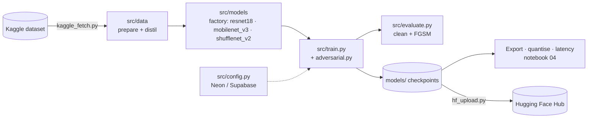

# 🏗 Architecture — ShiroNet

> Part of [shironet](https://github.com/shiroonigami23-ui/shironet). Back to the [README](../README.md).

## 1. System Overview

ShiroNet follows a layered pipeline: data acquisition and preparation, a model factory exposing interchangeable
backbones, a training loop with adversarial hooks, and evaluation/export stages. Infrastructure concerns (database,
secrets, Hugging Face) sit in a thin config layer so the ML code stays portable between laptop, Kaggle and Colab.
Diagrams and milestone tables also live in `docs/architecture/system-overview.md`.

## 2. Components

| Component | Location | Responsibility |
|---|---|---|
| **Data** | `src/data/` | Download, split, normalise and distil datasets |
| **Models** | `src/models/` | Backbone definitions and name-based factory |
| **Training** | `src/train.py, src/training/adversarial.py` | Optimiser loop, adversarial example generation, schedules |
| **Evaluation** | `src/evaluate.py` | Clean + adversarial accuracy, confusion matrix, PR curves |
| **Config** | `src/config.py` | Environment-driven settings and DB integration |
| **Scripts** | `scripts/` | Kaggle download, Hugging Face upload |
| **Kaggle kernels** | `kaggle/` | Reproducible GPU training and benchmark runs |

## 3. Data / Control Flow

1. Fetch the dataset from Kaggle into `data/raw` and prepare splits.
2. Build a backbone via the model factory.
3. Train with a schedule that mixes clean and adversarial batches.
4. Evaluate on clean and FGSM-perturbed test sets; write figures to `docs/assets/`.
5. Export / quantise and measure latency; upload the chosen checkpoint to Hugging Face.

## 4. Key Design Decisions

| Decision | Rationale |
|---|---|
| Factory pattern for backbones | Switch architectures from config without touching training code |
| Adversarial training as hooks | Robustness can be toggled per experiment |
| Notebook-first profiling | Deployment trade-offs are easier to explore interactively |
| Honest baselines | Comparisons use identical splits/backbones; no cross-dataset claims |

## 5. Known Limitations

- Robustness measured only with FGSM so far
- Benchmarks on a single dataset (Intel Scenes)

---
*Last updated: 2026-11-13*
